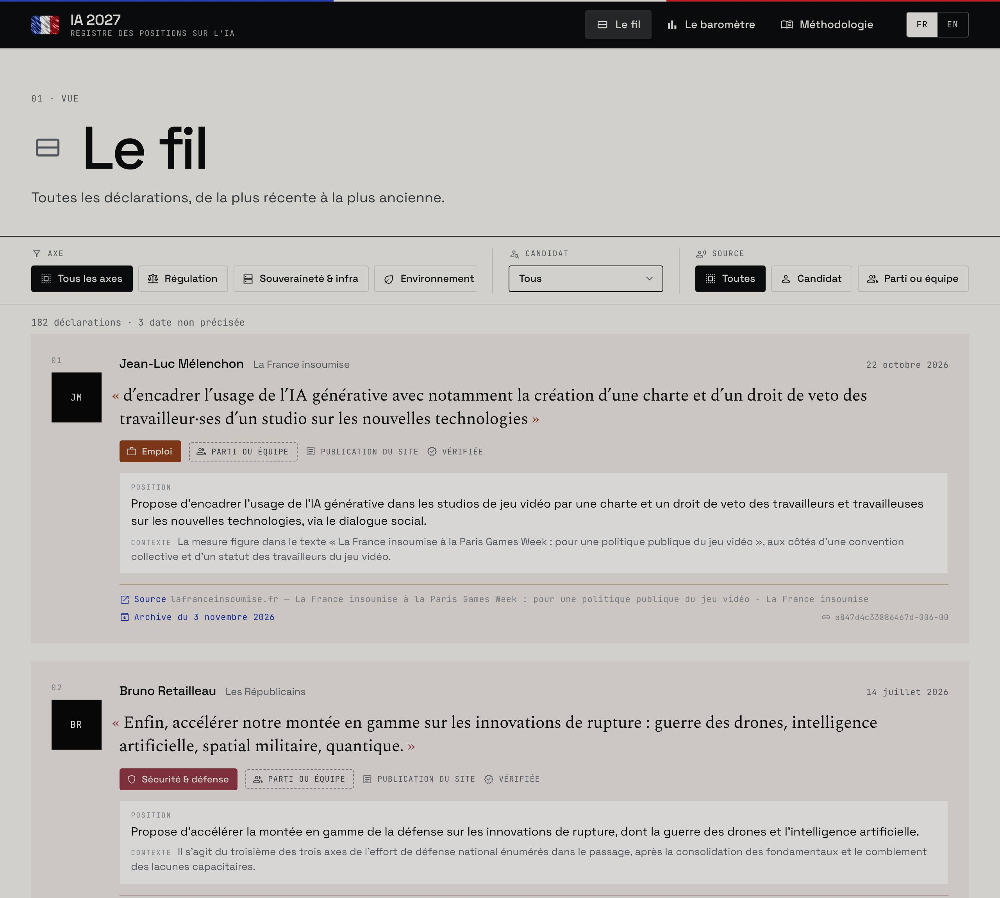
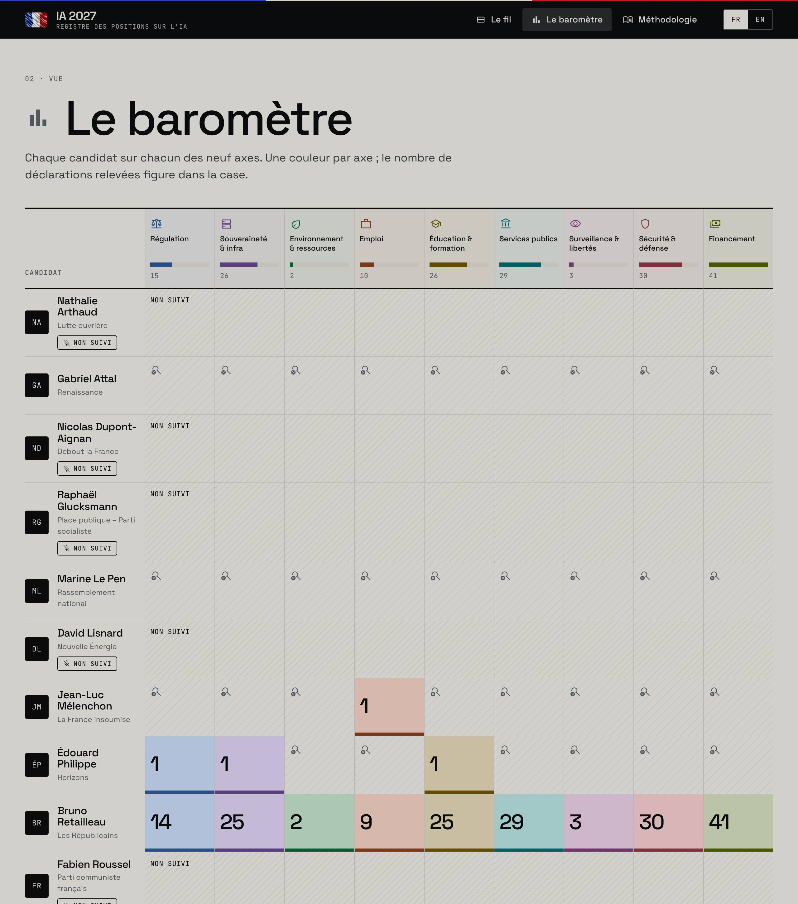
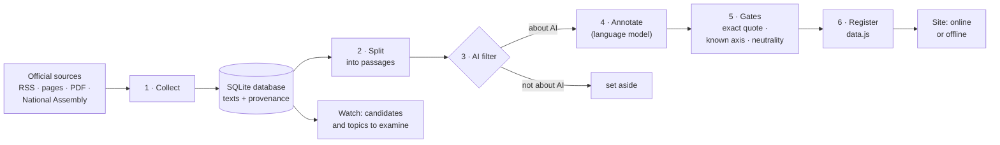

# Observatoire IA — French Presidential Election 2027

*[Version française](README.md). The French README is the reference; this is a translation.*

A public register of what the candidates in France's 2027 presidential election say
about artificial intelligence: **their exact words, dated, sourced, filed by subject**,
with no commentary and no rating. Published by the **ESSEC Metalab**.

> **Status: proof of concept online for demonstration, not officially published** (branch
> `poc`): **https://ia2027.the10x.tech**. The quotes are real; their classification is
> automated (Mistral) and **has not yet been reviewed by a person**. The site says so on
> every page.

| The feed: every statement, word for word | The barometer: every candidate against the ten axes |
|---|---|
|  |  |

---

## In short

- **What goes in:** public texts from the candidates themselves or their party: official
  websites, RSS feeds, PDF programmes, National Assembly transcripts.
- **What comes out:** a website, online or usable **with no internet connection**, listing
  every position on AI with its exact quote, its subject (one of ten axes), a neutral
  summary, the source and the date.
- **What never comes out:** a score, a ranking, a "tone" rating, an opinion. The register
  records; it does not judge.
- **When:** every morning at 08:00 (Paris time), collection, classification and the site
  update on their own; the site's "Actualiser les données" button runs the same update on
  demand. Editorial decisions (adding a candidate or a subject) stay human: the system
  **proposes** them in a watch note.

---

## The online version (branch `poc`)

**https://ia2027.the10x.tech**: the full register, updated every morning, with an
"Actualiser les données" (refresh) button at the bottom right.

- **The button** runs the same update as the 08:00 one (`scripts/daily.sh`), follows it,
  then reloads the page. One update at a time, and at most one every 10 minutes
  (`REFRESH_COOLDOWN_MINUTES`): each update reads the candidates' sites again under the
  Metalab's name, and a button pressed in a loop must not hammer them. Under the button,
  the date of the last update, whether it came from the button or the 08:00 job.
- **AI cost:** only new passages about AI go to Mistral. An update that finds nothing new
  makes **no** model call (about 4 minutes, mostly collection).
- **The server** is `observatoire web`: it serves the site and two endpoints, in standard
  Python, with no web framework: `GET /api/status` (update running, last update, next one
  allowed) and `POST /api/refresh` (202 started, 409 already running, 429 too soon).
- **The container** (`Dockerfile`, `scripts/container-start.sh`) holds the server and the
  08:00 update. On first start, with an empty volume, it builds the register from the
  previous version's data and the verified edition, with no model call (the same steps as
  `make site`); on every restart, it rebuilds the site from the database in a few seconds,
  so a new template shows at once.
- **Hosting:** Dokploy, an application built from the `poc` branch's `Dockerfile`, a
  persistent volume on `/app/data` (database, site, logs), variables
  `LLM_PROVIDER=mistral`, `MISTRAL_API_KEY`, `MISTRAL_MODEL=mistral-large-4-0`, `TZ`,
  `DAILY_TIME`. No automatic deployment: after a `git push` to `poc`, redeploy in Dokploy.
- **Caching:** the page is never cached, and it loads `data.js` and `refresh.js` with
  their content hash (`data.js?v=…`): a CDN that keeps scripts in browsers for hours
  (Cloudflare does) cannot show stale data.

---

## Read the register offline, with nothing to install

To read the register on any computer (Mac, Windows, Linux), without internet and without
installing Python or the project:

```bash
make package     # → dist/registre-ia-2027-hors-ligne.zip (≈ 800 KB), from the built site
```

On the reader's computer: unzip the archive, then double-click
"Ouvrir le registre (Mac).command" or "Ouvrir le registre (Windows).bat"
(Linux: `bash ouvrir-le-registre-linux.sh`). The browser opens on the register; the small
window that stays open is the local server, to close when done.
The archive's `LISEZ-MOI.txt` (in French) covers the macOS and Windows security prompts
on first launch.

A local server is required: opened directly (`file://`), the site would have no fonts or
components, which browsers block. The launcher uses what the system already ships —
python3 or perl on Mac and Linux, PowerShell on Windows — and listens on that computer
only. This copy is frozen: its build date is at the bottom of every page. For a register
updated every morning, install the full project (below).

---

## Start in five minutes

You need `git`, Python 3.11+, [`uv`](https://docs.astral.sh/uv/) and a macOS or Linux
machine (on Windows: [WSL](https://learn.microsoft.com/en-us/windows/wsl/install)).
On a fresh Mac: `xcode-select --install` (provides git and python3), then
`curl -LsSf https://astral.sh/uv/install.sh | sh` (or `brew install uv`) and reopen
Terminal.

```bash
git clone https://github.com/ESSEC-METALAB/ia-presidentielle.git
cd ia-presidentielle && git checkout poc
make install      # Python environment and dependencies
make site         # builds the register from the data already collected (≈ 1 min;
                  #   first fetches the previous version's database from GitHub)
make serve        # opens http://localhost:8000 — works without internet
```

For the automatic update every morning:

```bash
cp .env.example .env     # then set LLM_PROVIDER=mistral, MISTRAL_API_KEY and
                         #   MISTRAL_MODEL=mistral-large-4-0
make schedule            # installs the 08:00 update and keeps the site up locally
make schedule-status     # check; "make unschedule" removes everything
```

To try the site with its refresh button, as online:
`uv run observatoire web --host 127.0.0.1 --port 8000`.

Without a Mistral key everything still works: the site is rebuilt every morning, and new
passages about AI are shown as "pending" until they are classified.

---

## How it works



The `observatoire …` commands run inside the project environment: `uv run observatoire …`,
or more simply the matching `make` targets.

| Step | What it does | Command |
|---|---|---|
| 1. Collect | Reads the sources declared in `config/sources.yaml`, honouring `robots.txt` and a delay between requests. Keeps the URL, the publication date (never guessed) and the fetch time. A text already seen is not stored twice, nor a page read again with small extraction differences (95 % of five-word sequences shared with the stored version, `near_duplicate_similarity`). | `observatoire collect` |
| 2. Split | Cuts each text into passages readable on their own and removes noise (cookie banners, page numbers, Assembly stage directions…). Every passage set aside keeps its reason. | `observatoire segment` |
| 3. AI filter | Keeps only passages about AI: one strong term ("intelligence artificielle", "IA", "algorithme"…) or two distinct weak ones ("numérique", "données"…). | (inside `annotate`) |
| 4. Annotate | A language model (Mistral, `mistral-large-4-0`) reads each kept passage and proposes its statements: quote, axis, summary, context, translation. **"Nothing" is the expected answer for most passages.** A passage already annotated, or covered as it is by a verified edition, is not sent again. | `observatoire annotate` |
| 5. Gates | Code rejects any proposal whose quote is not word for word in the text, whose axis is unknown, or whose summary contains a judgement word. The stored quote is the source's own text, never the model's copy. | (inside `annotate`) |
| 6. Register | Picks the annotation each passage shows (a verified edition first, else the day's annotator, else "pending"), attaches its provenance (candidate, source, date, archive) from the database, then writes the site. | `observatoire register` |
| Watch | Compares our candidate list with an outside list, counts subjects that are not yet axes, lists pending passages. Changes nothing. | `observatoire watch` |

### Every morning at 08:00

`make schedule` installs on the machine (launchd on macOS, systemd or cron on Linux):

1. **the update** (`scripts/daily.sh`), at 08:00 local time: collect → import from the
   previous version → split → annotate → watch → site. A failed step does not stop the
   next ones; the day's log is in `data/logs/`, with a summary. Machine asleep at 08:00:
   the update runs at wake-up (macOS, systemd). Machine off: caught up at boot with
   systemd, skipped with launchd and cron;
2. **the site server**, on `http://localhost:8000`, restarted if it stops (with cron:
   checked every ten minutes). If there is no site yet, `make schedule` first runs an
   update.

Online, the container runs the same update every day at `DAILY_TIME` (08:00, time zone
`TZ=Europe/Paris`): see "The online version".

On macOS, the repository must not live in Documents, Desktop, Downloads or iCloud Drive:
macOS forbids those folders to scheduled jobs (`make schedule` refuses and says what to
do). A folder such as `~/ia-presidentielle` is fine.

| Automatic | Proposed in the watch note | Human decision |
|---|---|---|
| collect, split, classify, check, rebuild the site | a declared candidate missing from the register, a reported withdrawal, a recurring subject that is not an axis | listing a candidate or a source, creating an axis, reviewing and validating statements |

Why candidates are not added automatically: listing follows a written rule (public
declaration and representativeness, `docs/methodology.md`). A script listing someone on
its own, during a campaign, under an institution's name, would risk exactly the unequal
treatment the register exists to avoid.

---

## Data sources

**Window:** texts published since **1 July 2026** (`config/sources.yaml`). An undated
text is kept and shown as "date not specified": a missing date is not evidence of age.

| Source | Candidate | Level | Note |
|---|---|---|---|
| Programme "L'IA au service des Français" (PDF, 7 July 2026) | Bruno Retailleau | 1 | 167 of Bruno Retailleau's 178 statements |
| republicains.fr RSS feed | Bruno Retailleau | 2 | |
| National Assembly transcripts (open data) | Bruno Retailleau | 1, confirmed | ministerial interventions, until 2025: nothing in the window |
| lafranceinsoumise.fr RSS feed; melenchon.fr blog | Jean-Luc Mélenchon | 2; 1 | |
| "Priorités" page, Adidas Arena speech (5 July 2026); "L'école" Q&A | Édouard Philippe | 1; 2 | edouardphilippe.fr |
| Programme page on AI (attalpresident.fr) | Gabriel Attal | 1 | |
| National Assembly transcripts | Gabriel Attal, Marine Le Pen, François Ruffin | 1, confirmed | the transcript names the speaker |
| Rally speech of 26 September 2026; Lutte ouvrière RSS feed | Nathalie Arthaud | 1; 2 | disabled: off the register since 6 November |
| Debout la France RSS feed | Nicolas Dupont-Aignan | 2 | disabled: off the register since 6 November |
| Place publique RSS feed; "Lettre aux Français" | Raphaël Glucksmann | 2; 1 | |
| Two Nouvelle Énergie pages (his view of AI, his book on AI) | David Lisnard | 2 | no feed on the site |
| PCF digital commission RSS feed; Fête de l'Humanité 2026 speech | Fabien Roussel | 2; 1 | |
| francoisruffin.fr RSS feed | François Ruffin | 1 | |
| marinetondelier.fr blog; Les Écologistes' digital booklet (PDF, July 2026) | Marine Tondelier | 1; 2 | |
| Parti socialiste RSS feed, Assembly | Olivier Faure | 2 / 1 | no longer running since 11 October, shown since 6 November; the feed is not attributed to Raphaël Glucksmann, its texts are signed by Olivier Faure or the party's bodies |
| Previous version's database (branch `daily`, GitHub Actions) | all monitored | — | a bridge while the old collection runs |
| MieuxVoter list of candidacies (community) | — | — | **watch only**, never evidence |

**Source levels** ("who is speaking", not "who hosts it"):

| Level | Content | Use in the register |
|---|---|---|
| 1 | The candidate's own words: programme, speeches, interventions | statement |
| 2 | Their party or campaign team, speaking on their behalf | statement, level shown |
| 3 | The press writing about the candidate | never a statement |
| 4 | Third-party analysis and commentary | never a statement |

A source's level is a **default**, shown dashed as "unconfirmed": a party website carries
both its own press releases and the candidate's speeches. Only the National Assembly
transcript, which names the speaker, is confirmed from the start.

**Ruled out, with reasons** (`docs/methodology.md`): the press as a source of positions;
social networks (paid X API, not wired); auto-captioned video (no indication of who is
speaking); open-web crawling (an arbitrary page cannot say whose words it carries).

The sources added on 4 November were each fetched from a networked machine with the
project's own `robots.txt` policy, client and extraction settings before entering
`config/sources.yaml` (the details, and what was left out, are noted there).

**Untracked candidate:** Éric Zemmour. No official source passes the checks (no feed,
generic pages, news published as embedded Instagram posts); the site marks him "Not
tracked". Marine Le Pen is tracked only at the Assembly: the Rassemblement national's
site refuses our agent.

### Compliance

- `robots.txt` checked before every request, including on each redirect; a site that does
  not answer is treated as disallowing.
- An identifiable user agent (`ESSECMetalabBot/1.0`, with the Metalab's address) and a
  minimum delay between two requests to the same site (`config/sources.yaml`, `crawler`).
- RSS feeds and open data first; never a page behind a paywall.
- Only statements by candidates and their parties are collected: no user comments, no
  personal data about third parties.
- Political opinions are sensitive data under the GDPR: the legal framework must be
  validated before any publication.

---

## The analysis: what is produced

**A statement** is:

| Field | Example | Where it comes from |
|---|---|---|
| Quote | « Je propose un plan d'urgence numérique, le « plan Vauban »… » | the source text, word for word |
| Axis | AI for defence | proposed by the model, checked |
| Summary | Proposes a digital emergency plan… | model, checked (no judgement words) |
| Context | Text published on the Les Républicains website… | model, checked |
| Translation | I propose a digital emergency plan… | model (a reading aid only) |
| Candidate, source, date, level, archive | Bruno Retailleau, republicains.fr, 7 July 2026… | **the code**, from the database; never the model |

**The ten axes** (`config/taxonomy.yaml`, revised on 9 November 2026). An axis names a subject, never a direction:

| Axis | What it covers |
|---|---|
| Regulation | rules, bans, oversight, liability, or an explicit deregulation stance |
| Sovereignty & infra | sovereign cloud, compute, chips, data, dependence on foreign providers |
| Energy | electricity and nuclear power for compute, the grid, water and electricity use of data centres, siting, carbon footprint; including energy framed as a national asset |
| Jobs | jobs created or displaced, automation, labour law |
| Education & training | schools, universities, engineers, reconversion; a measure delivered as training stays here even if it aims at jobs |
| Public services | AI inside the state, administration, healthcare, fraud detection |
| Surveillance & liberties | facial recognition, policing, algorithmic decisions, privacy |
| AI for defence | armed forces, drones and autonomous weapons, intelligence, cyberdefence, critical infrastructure, interference, disinformation |
| Model security | safety and security of AI systems themselves: robustness, attacks on models, evaluation of advanced models; labelling generated content stays under regulation |
| Funding | public and private investment, tax, procurement, budgets |

**What the analysis does not do:** no score, no ranking, no "for / against" orientation,
no tone or sentiment, no prediction. Those are judgements; published under an
institution's name during a campaign, they would be the first risk to its neutrality
(ADR 0002).

**Verified editions and the day's annotation.** Each passage shows one annotation, in this
order (`config/register.yaml`):

1. a **verified edition's**, if it covers the passage as it is now: "Verified" badge;
2. otherwise the **day's annotator's** (Mistral): "Automatic checks" badge;
3. otherwise the passage is **pending**, and the site says so.

A morning update therefore never replaces a verified edition; it fills in what the
edition does not cover.

**The edition of 3 November 2026** (retired on 9 November: it was classified on the nine former axes, and its statements are reclassified by Mistral on the ten new ones) was classified offline by an AI assistant (Mistral could
not be reached from the development environment), with the same prompt and schema Mistral
gets, then checked statement by statement by **six independent automated verifiers — AI
assistants, not people** (substance ×3, axis ×2, fidelity ×1): 188 proposals, 6 dropped, 1
axis changed, 45 statements with corrected notes (summary, context or translation), 182
statements published. Everything is versioned in `annotations/`.

**The day's annotator, since 4 November 2026:** Mistral, `mistral-large-4-0`, a model that
reasons before answering. Its first real calls showed two differences from the
documentation, fixed in `adapters/llm/mistral_client.py`: `top_p` must be 1 with a zero
temperature, and the answer arrives in chunks (reasoning, then text), of which only the
text is kept. A call can take over a minute: 180 s timeout (`LLM_TIMEOUT_SECONDS`).
Count about 2,600 generated tokens per annotated passage.

---

## What you get

| Where | What |
|---|---|
| https://ia2027.the10x.tech, or `data/site/` → `http://localhost:8000` | **The register**, in French and English: the feed, the barometer, one page per candidate with their portrait, the methodology. The local copy works without internet. |
| `data/reports/veille.md` | **The morning watch note**: candidates and topics to examine, pending passages. |
| `data/reports/corpus.html` | The raw corpus, source by source: what was collected, split or set aside, and why. |
| `data/logs/daily-YYYY-MM-DD.log` | The log of each update, with a step-by-step summary. |
| `annotations/` | The recorded annotation answers and the verification: the provenance of every statement. |
| `observatoire usage` | Tokens used by the model, per step. |

---

## How to read the register

- **A quote is exact**: the code extracts it from the source text. The "Source" link leads
  to the text, the "Archive" link to a dated copy when one exists.
- **The level** says who is speaking: "Candidate" (level 1) or "Party or staff"
  (level 2). A **solid** border = confirmed; **dashed** = assigned by default, to confirm.
- **"Verified"**: the statement comes from an edition checked by the six automated
  verifiers. **"Automatic checks"**: it passed only the code's checks. None has been
  reviewed by a person yet.
- **The barometer counts statements, not their importance.** A brief sentence and a
  detailed reform each count as one. A programme devoted to AI therefore fills many cells
  mechanically.
- **"No position identified"** (magnifier): we read this candidate's sources and found
  nothing on this axis. **"Pending"** (hourglass): passages by this candidate about AI are
  not classified yet; nothing is established. **"Not tracked"** (hatching): no source is
  configured; we can say nothing about their silence.
- **What not to conclude**: that a candidate is "more" or "less" in favour of AI, that
  they talk about it more than another (that depends first on our sources), or that a
  position is good or bad.

**Warning about the current edition (5 November 2026):** 287 statements, 182 from the
verified edition and 105 classified by Mistral. 178 are Bruno Retailleau's, 167 of them
from his programme devoted to AI; next come Marine Tondelier, Édouard Philippe, David
Lisnard and Gabriel Attal. Three tracked candidates have no statement (Nicolas
Dupont-Aignan, Raphaël Glucksmann, Marine Le Pen: "no position identified" in our
sources), one is not tracked (Éric Zemmour). The imbalance measures **our sources** first,
not the candidates' interest in AI.

---

## Code architecture

Hexagonal architecture: the core (domain, use cases) knows nothing of the internet, the
database or the language model; it talks to interfaces ("ports") that adapters implement.
Changing the model provider, the database or a source does not touch the core.

```
cli.py  (wires the pieces together)
   │
   ├─ application/   the use cases: collect_daily · segment_documents · annotate_documents
   │                 · build_register · watch_changes · inspect_corpus
   ├─ domain/        models and ports, with no outside dependency
   ├─ services/      deterministic rules: dedup, splitting, AI filter, gates
   └─ adapters/      the real world: sources (RSS, page, PDF, Assembly), extraction,
                     llm (Mistral, fake, recorded, batch), SQLite storage, rendering (site, watch),
                     web (the online site's server and its refresh button)
```

```
config/         candidates, sources, splitting, axes and gates, watch, verified editions
web/registre/   the site (prototype v3), its libraries and fonts, the portraits
                (.image-slots.state.json) and refresh.js, the refresh button
annotations/    versioned annotation answers and verification
scripts/        daily.sh (update), serve.sh (site), schedule.sh (scheduling),
                package.sh (offline archive), container-start.sh (online container)
Dockerfile      the online server's image (site, button, 08:00 update)
packaging/      launchers and tiny servers of the offline archive (Mac, Windows, Linux)
docs/           methodology.md (rules and findings), sources-a-verifier.md, adr/
tests/          328 tests, no network or key; 100 % coverage of domain and use cases
```

| Command | Role |
|---|---|
| `make site` | the whole register, no API key, from the previous version's data (fetched from GitHub; offline, the last copy) |
| `make daily` | the morning update, by hand |
| `make serve` | the site on `http://localhost:8000` |
| `uv run observatoire web` | the site with its refresh button and `/api/status`, `/api/refresh` (what the online container serves) |
| `make schedule` / `unschedule` / `schedule-status` | install, remove, check the 08:00 job and the server |
| `make watch` | the watch note alone |
| `make annotate` | classify pending passages with Mistral (`.env`); without a key, a dry run that writes nothing |
| `make check` | lint, strict typing, tests, coverage: must pass before any commit |
| `make help` | every command |

---

## Evolving the register

- **Add a candidate**: an entry in `config/candidates.yaml` (candidacy status and the
  sources establishing it), after checking the inclusion rule.
- **Add a source**: fetch it, check its `robots.txt` and that it extracts, then an entry
  in `config/sources.yaml` (kind, URL, level). No code for an RSS feed, a page, a PDF or a
  deputy.
- **Add or change an axis**: `config/taxonomy.yaml`. The prompt then changes version:
  with Mistral, every passage is reclassified on the next update; without a key, the
  recorded answers no longer match and the passages become "pending".
- **Publish a verified edition**: once its answers are verified and recorded, add it to
  `config/register.yaml`; it then takes precedence over the day's annotation.
- **Change the model**: `MISTRAL_MODEL` in `.env` (online: in Dokploy's variables).
  Another provider = a new adapter in `adapters/llm/`, without touching the use cases.
- **Add a portrait**: a `portrait-<candidate id>` entry in
  `web/registre/.image-slots.state.json` (a JPEG data URL, 4:5, black and white, like the
  others) and its credit in the legal notices (`web/registre/index.html`). The current
  portraits come from Wikimedia Commons (`web/registre/NOTICE.md`).
- **Deploy**: `git push` to `poc`, then redeploy the application in Dokploy. The database
  and the logs, on the volume, are kept.

---

## Known limits and open decisions

- No statement has been **reviewed by a person** yet.
- **Uneven coverage**: 12 candidates tracked out of 13, but very unevenly (see the warning
  above). Readers to write: the Sénat (Bruno Retailleau since November 2025), the European
  Parliament (Raphaël Glucksmann), site archives (`sitemap`). La France insoumise's
  programme, announced for 6 November, is to be added.
- The **level** of the three personal blogs (Ruffin, Tondelier, Mélenchon) is a default
  for an editor to confirm. On WordPress sites, the date extracted from a page can be that
  of its last change.
- The **portraits** are free-licensed or reusable with attribution: the credits are to be
  checked one last time before publication. The screenshots in this README predate them.
- The licence of the flag animation (adapted from React Bits' "Silk" shader) is to be
  confirmed before publication (`web/registre/NOTICE.md`).
- The **Parti socialiste** feed stays attributed to Olivier Faure, who withdrew: it is not
  attributed to Raphaël Glucksmann (joint candidate since 11 October), because its texts
  since then are signed by Olivier Faure or the party's bodies, not by him.
- Before any publication: a publication director, legal notices, a GDPR framework
  (political opinions are sensitive data), legal review.

Further reading: [`docs/methodology.md`](docs/methodology.md) (every rule and the measured
findings, in French), [`docs/adr/`](docs/adr) (architecture decisions),
[`CLAUDE.md`](CLAUDE.md) (coding rules), [`PROMPT_BOOTSTRAP.md`](PROMPT_BOOTSTRAP.md)
(the prototype's brief).
