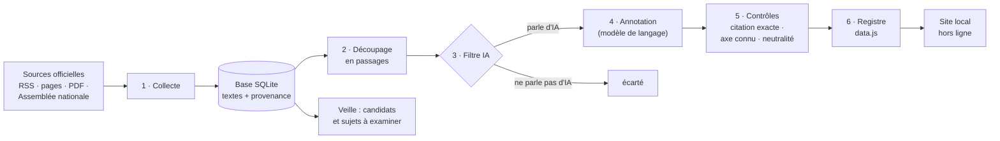

# Observatoire IA — Présidentielle 2027

*[English version](README.en.md).*

Un registre public de ce que les candidats à l'élection présidentielle de 2027 disent de
l'intelligence artificielle : **leurs mots exacts, datés, sourcés, classés par sujet**,
sans commentaire ni note. Publié par l'**ESSEC Metalab**.

> **Statut : prototype, non publié.** Les citations sont réelles ; leur classement est
> automatique et **n'a pas encore été relu par un éditeur**. Le site le dit sur chaque page.

| Le fil : chaque déclaration, mot pour mot | Le baromètre : chaque candidat face aux neuf axes |
|---|---|
|  |  |

---

## En bref

- **Ce qui entre :** des textes publics venant des candidats eux-mêmes ou de leur parti :
  sites officiels, flux RSS, programmes en PDF, comptes rendus de l'Assemblée nationale.
- **Ce qui sort :** un site local, consultable **sans connexion**, qui liste chaque prise
  de position sur l'IA avec sa citation exacte, son sujet (un des neuf axes), un résumé
  neutre, la source et la date.
- **Ce qui n'en sort jamais :** un score, un classement, une note de « tonalité », une
  opinion. Le registre enregistre ; il ne juge pas.
- **Quand :** chaque matin à 8 h, la collecte, le classement et le site se mettent à jour
  tout seuls. Les décisions éditoriales (ajouter un candidat, un sujet) restent humaines :
  le système les **propose** dans une note de veille.

---

## Démarrer en cinq minutes

Il faut `git`, Python 3.11+, [`uv`](https://docs.astral.sh/uv/) et une machine macOS ou
Linux (sous Windows : [WSL](https://learn.microsoft.com/fr-fr/windows/wsl/install)).

```bash
git clone https://github.com/ESSEC-METALAB/ia-presidentielle.git
cd ia-presidentielle && git checkout archi
make install      # environnement Python et dépendances
make site         # construit le registre avec les données déjà collectées (≈ 1 min)
make serve        # ouvre http://localhost:8000 — fonctionne sans internet
```

Pour la mise à jour automatique chaque matin :

```bash
cp .env.example .env     # puis renseigner LLM_PROVIDER=mistral, MISTRAL_API_KEY, MISTRAL_MODEL
make schedule            # installe la mise à jour de 8 h et garde le site en ligne en local
make schedule-status     # vérifier ; « make unschedule » pour tout retirer
```

Sans clé Mistral, tout fonctionne aussi : le site est reconstruit chaque matin et les
nouveaux passages attendent leur classement (la note de veille les compte).

---

## Comment ça marche



| Étape | Ce qu'elle fait | Commande |
|---|---|---|
| 1. Collecte | Lit les sources déclarées dans `config/sources.yaml`, en respectant `robots.txt` et un délai entre requêtes. Garde l'URL, la date de publication (jamais devinée) et l'heure de collecte. Un texte déjà vu n'est pas stocké deux fois. | `observatoire collect` |
| 2. Découpage | Coupe chaque texte en passages lisibles seuls et retire le bruit (bandeaux de cookies, numéros de page, didascalies de l'Assemblée…). Chaque passage écarté garde son motif. | `observatoire segment` |
| 3. Filtre IA | Ne garde que les passages qui parlent d'IA : un terme fort (« intelligence artificielle », « IA », « algorithme »…) ou deux termes faibles distincts (« numérique », « données »…). | (dans `annotate`) |
| 4. Annotation | Un modèle de langage lit chaque passage retenu et propose ses déclarations : citation, axe, résumé, contexte, traduction. **« Rien » est la réponse attendue pour la plupart des passages.** | `observatoire annotate` |
| 5. Contrôles | Le code rejette toute proposition dont la citation n'est pas mot pour mot dans le texte, dont l'axe est inconnu, ou dont le résumé contient un mot de jugement. La citation enregistrée est celle de la source, jamais la copie du modèle. | (dans `annotate`) |
| 6. Registre | Joint à chaque déclaration sa provenance (candidat, source, date, archive) depuis la base, puis écrit le site. | `observatoire register` |
| Veille | Compare la liste des candidats à une liste extérieure, compte les sujets qui ne sont pas encore des axes, liste les passages en attente. Ne modifie rien. | `observatoire watch` |

### Chaque matin à 8 h

`make schedule` installe sur la machine (launchd sous macOS, systemd ou cron sous Linux) :

1. **la mise à jour** (`scripts/daily.sh`), à 8 h heure locale : collecte → import de la
   version précédente → découpage → annotation → veille → site. Si la machine dormait à
   8 h, elle tourne au réveil (macOS, systemd). Une étape en échec n'arrête pas les
   suivantes ; le journal du jour est dans `data/logs/`, avec un bilan à la fin ;
2. **le serveur du site**, sur `http://localhost:8000`, relancé s'il s'arrête.

| Automatique | Proposé dans la note de veille | Décision humaine |
|---|---|---|
| collecter, découper, classer, contrôler, reconstruire le site | un candidat déclaré absent du registre, un retrait signalé, un sujet récurrent qui n'est pas un axe | inscrire un candidat ou une source, créer un axe, relire et valider les déclarations |

Pourquoi ne pas ajouter les candidats automatiquement : l'inscription suit une règle
écrite (déclaration publique et représentativité, `docs/methodology.md`). Un script qui
inscrirait seul quelqu'un, pendant une campagne, sous le nom d'une institution,
risquerait précisément le traitement inégal que le registre doit éviter.

---

## Les sources de données

**Fenêtre :** les textes publiés depuis le **1er juillet 2026** (`config/sources.yaml`).
Un texte sans date est gardé et affiché « date non précisée » : une date absente n'est pas
une preuve d'ancienneté.

| Source | Candidat | Niveau | Remarque |
|---|---|---|---|
| Programme « L'IA au service des Français » (PDF, 7 juillet 2026) | Bruno Retailleau | 1 | 167 des 182 déclarations actuelles |
| Flux RSS de republicains.fr | Bruno Retailleau | 2 | |
| Flux RSS de lafranceinsoumise.fr | Jean-Luc Mélenchon | 2 | |
| Page « Priorités » d'edouardphilippe.fr | Édouard Philippe | 1 | |
| Comptes rendus de l'Assemblée nationale (open data) | Gabriel Attal, Marine Le Pen | 1, confirmé | le compte rendu nomme l'orateur |
| Flux RSS du Parti socialiste, Assemblée | Olivier Faure | 2 / 1 | retiré le 11 octobre : hors registre |
| Base de la version précédente (branche `daily`, GitHub Actions) | tous les suivis | — | pont, tant que l'ancienne collecte tourne |
| Liste MieuxVoter des candidatures (communautaire) | — | — | **veille seulement**, jamais une preuve |

**Niveaux de source** (« qui parle », pas « qui héberge ») :

| Niveau | Contenu | Usage dans le registre |
|---|---|---|
| 1 | Les mots du candidat : programme, discours, interventions | déclaration |
| 2 | Son parti ou son équipe, parlant en son nom | déclaration, niveau signalé |
| 3 | La presse parlant du candidat | jamais une déclaration |
| 4 | Analyses et commentaires de tiers | jamais une déclaration |

Le niveau d'une source est une valeur **par défaut**, affichée en pointillés « non
confirmé » : un site de parti publie aussi bien ses communiqués que les discours du
candidat. Seul le compte rendu de l'Assemblée, qui nomme l'orateur, est confirmé d'office.

**Écartés, avec raison** (`docs/methodology.md`) : la presse comme source de positions ;
les réseaux sociaux (API X payante, non branchée) ; les vidéos sous-titrées
automatiquement (aucune indication de qui parle) ; la navigation libre sur le web (une page
quelconque ne dit pas de qui sont les mots).

**Candidats non suivis :** huit candidats déclarés n'ont pas encore de source vérifiée ;
le site les marque « Non suivi ». Leurs sites officiels ont été repérés :
`docs/sources-a-verifier.md`.

### Conformité

- `robots.txt` respecté avant toute requête, y compris à chaque redirection ; un site qui
  ne répond pas est traité comme interdit.
- Un agent identifiable (`ESSECMetalabBot/1.0`, avec l'adresse du Metalab) et un délai
  minimal entre deux requêtes sur un même site (`config/sources.yaml`, `crawler`).
- Flux RSS et données ouvertes d'abord ; jamais de page derrière un mur payant.
- Seules les prises de parole des candidats et de leurs partis sont collectées : aucun
  commentaire d'internaute, aucune donnée personnelle de tiers.
- Les opinions politiques sont des données sensibles au sens du RGPD : le cadre juridique
  doit être validé avant toute publication.

---

## L'analyse : ce qui est produit

**Une déclaration**, c'est :

| Champ | Exemple | D'où il vient |
|---|---|---|
| Citation | « Je propose un plan d'urgence numérique, le « plan Vauban »… » | le texte source, mot pour mot |
| Axe | Sécurité & défense | proposé par le modèle, contrôlé |
| Résumé | Propose un plan d'urgence numérique… | modèle, contrôlé (aucun mot de jugement) |
| Contexte | Texte publié sur le site des Républicains… | modèle, contrôlé |
| Traduction | I propose a digital emergency plan… | modèle (aide à la lecture seulement) |
| Candidat, source, date, niveau, archive | Bruno Retailleau, republicains.fr, 7 juillet 2026… | **le code**, depuis la base ; jamais le modèle |

**Les neuf axes** (`config/taxonomy.yaml`). Un axe nomme un sujet, jamais une direction :

| Axe | Ce qu'il couvre |
|---|---|
| Régulation | règles, interdictions, contrôle, responsabilité, ou dérégulation assumée |
| Souveraineté & infra | cloud souverain, puissance de calcul, dépendance aux fournisseurs étrangers ; l'énergie comme atout national |
| Environnement & ressources | eau et électricité des centres de données, implantation, empreinte carbone |
| Emploi | emplois créés ou supprimés, automatisation, droit du travail |
| Éducation & formation | école, université, ingénieurs, reconversion ; une mesure de formation reste ici même si elle vise l'emploi |
| Services publics | l'IA dans l'État, l'administration, la santé, la lutte contre la fraude |
| Surveillance & libertés | reconnaissance faciale, police, décisions algorithmiques, vie privée |
| Sécurité & défense | cyberdéfense, infrastructures critiques, IA militaire, ingérences, désinformation |
| Financement | investissement public et privé, fiscalité, commande publique, budgets |

**Ce que l'analyse ne fait pas :** pas de score, pas de classement, pas d'orientation
« pour / contre », pas de tonalité ni de sentiment, pas de prédiction. Ce sont des
jugements ; publiés sous le nom d'une institution en pleine campagne, ils seraient le
premier risque pour sa neutralité (ADR 0002).

**L'édition du 3 novembre 2026** a été classée hors ligne par un assistant (Mistral
n'était pas joignable depuis l'environnement de développement), avec la même consigne et
le même schéma que Mistral, puis **vérifiée par six vérificateurs indépendants** par
déclaration (fond ×3, axe ×2, fidélité ×1) : 188 propositions, 6 écartées, 1 axe changé,
45 résumés corrigés, 182 déclarations publiées. Tout est versionné dans `annotations/`.

---

## Ce que vous obtenez

| Où | Quoi |
|---|---|
| `data/site/` → `http://localhost:8000` | **Le registre**, en français et en anglais : le fil, le baromètre, une page par candidat, la méthodologie. Fonctionne sans internet. |
| `data/reports/veille.md` | **La note de veille** du matin : candidats et sujets à examiner, passages en attente. |
| `data/reports/corpus.html` | Le corpus brut, source par source : ce qui a été collecté, découpé ou écarté, et pourquoi. |
| `data/logs/daily-AAAA-MM-JJ.log` | Le journal de chaque mise à jour, avec un bilan étape par étape. |
| `annotations/` | Les réponses d'annotation enregistrées et la vérification : la provenance de chaque déclaration. |
| `observatoire usage` | Les jetons consommés par le modèle, par étape. |

---

## Comment lire le registre

- **Une citation est exacte** : elle est extraite du texte source par le code. Le lien
  « Source » mène au texte, le lien « Archive » à une copie datée quand elle existe.
- **Le niveau** dit qui parle : « Candidat » (niveau 1) ou « Parti ou équipe » (niveau 2).
  Un cadre **plein** = confirmé ; **en pointillés** = attribué par défaut, à confirmer.
- **Le baromètre compte des déclarations, pas leur importance.** Une phrase brève et une
  réforme détaillée comptent chacune pour une. Un programme consacré à l'IA produit donc
  mécaniquement beaucoup de cases remplies.
- **« Aucune position identifiée »** (loupe) : nous avons lu les sources de ce candidat et
  n'avons rien trouvé sur cet axe. **« Non suivi »** (hachures) : aucune source n'est
  configurée ; nous n'écoutons pas, nous ne pouvons rien dire de son silence.
- **Ce qu'il ne faut pas en conclure** : qu'un candidat est « plus » ou « moins » favorable
  à l'IA, qu'il en parle plus qu'un autre (cela dépend d'abord de nos sources), ou qu'une
  position est bonne ou mauvaise.

**Avertissement sur l'édition actuelle :** 178 des 182 déclarations sont de Bruno
Retailleau, dont 167 tirées de son seul programme IA. Ce déséquilibre mesure **nos
sources** (8 candidats non suivis, 2 suivis seulement à l'Assemblée), pas l'intérêt des
candidats pour l'IA. À corriger avant toute publication.

---

## Architecture du code

Architecture hexagonale : le cœur (domaine, cas d'usage) ne connaît ni internet, ni la
base, ni le modèle de langage ; il parle à des interfaces (« ports ») que des adaptateurs
implémentent. Changer de fournisseur de modèle, de base ou de source ne touche pas le cœur.

```
cli.py  (assemble les pièces)
   │
   ├─ application/   les cas d'usage : collect_daily · segment_documents · annotate_documents
   │                 · build_register · watch_changes · inspect_corpus
   ├─ domain/        les modèles et les ports, sans aucune dépendance extérieure
   ├─ services/      règles déterministes : dédoublonnage, découpage, filtre IA, contrôles
   └─ adapters/      le monde réel : sources (RSS, page, PDF, Assemblée), extraction,
                     llm (Mistral, faux, enregistré, batch), stockage SQLite, rendu (site, veille)
```

```
config/         candidats, sources, découpage, axes et contrôles, veille — aucun code
web/registre/   le site (prototype v3) et ses bibliothèques et polices, pour le hors-ligne
annotations/    réponses d'annotation versionnées et vérification
scripts/        daily.sh (mise à jour), serve.sh (site), schedule.sh (planification)
docs/           methodology.md (règles et constats), sources-a-verifier.md, adr/
tests/          279 tests, sans réseau ni clé ; couverture 100 % du domaine et des cas d'usage
```

| Commande | Rôle |
|---|---|
| `make site` | tout le registre, hors ligne, depuis les données de la version précédente |
| `make daily` | la mise à jour du matin, à la main |
| `make serve` | le site sur `http://localhost:8000` |
| `make schedule` / `unschedule` / `schedule-status` | installer, retirer, vérifier la tâche de 8 h et le serveur |
| `make watch` | la note de veille seule |
| `make annotate` | classer les passages en attente avec le fournisseur de `.env` |
| `make check` | lint, typage strict, tests, couverture : à passer avant tout commit |
| `make help` | toutes les commandes |

---

## Faire évoluer le registre

- **Ajouter un candidat** : une entrée dans `config/candidates.yaml` (statut de
  candidature et sources qui l'établissent), après vérification de la règle d'inclusion.
- **Ajouter une source** : la récupérer, vérifier son `robots.txt` et son extraction, puis
  une entrée dans `config/sources.yaml` (type, URL, niveau). Aucun code à écrire pour un
  flux RSS, une page, un PDF ou un député.
- **Ajouter ou modifier un axe** : `config/taxonomy.yaml`. La consigne change donc de
  version : tous les passages sont reclassés au passage suivant.
- **Changer de modèle** : `MISTRAL_MODEL` dans `.env`. Un autre fournisseur = un nouvel
  adaptateur dans `adapters/llm/`, sans toucher aux cas d'usage.

---

## Limites connues et décisions ouvertes

- Aucune déclaration n'a encore été **relue par une personne**.
- Le **client Mistral** a été écrit d'après la documentation et testé contre une réponse
  simulée ; son premier appel réel se fera sur votre machine.
- **Couverture inégale** : 5 candidats suivis sur 13 (voir l'avertissement ci-dessus).
- Le flux du **Parti socialiste** reste rattaché à Olivier Faure, retiré ; le rattacher à
  Raphaël Glucksmann (candidat commun depuis le 11 octobre) est une décision éditoriale.
- Avant toute publication : directeur de la publication, mentions légales, cadre RGPD
  (les opinions politiques sont des données sensibles), relecture juridique.

Pour aller plus loin : [`docs/methodology.md`](docs/methodology.md) (toutes les règles et
les constats chiffrés), [`docs/adr/`](docs/adr) (décisions d'architecture),
[`CLAUDE.md`](CLAUDE.md) (règles de code), [`PROMPT_BOOTSTRAP.md`](PROMPT_BOOTSTRAP.md)
(cahier des charges du prototype).
