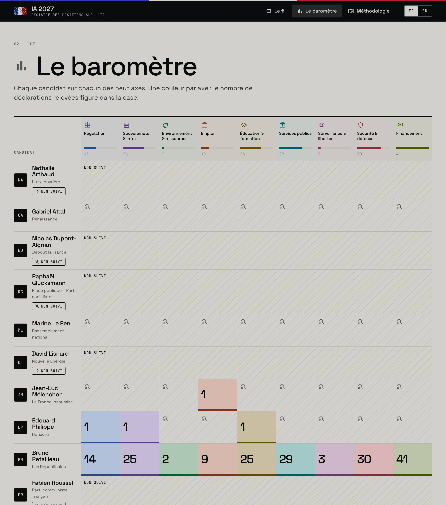
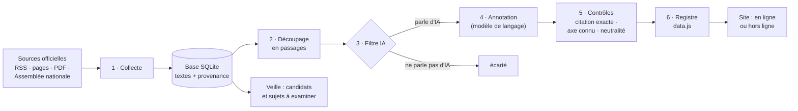

# Observatoire IA — Présidentielle 2027

*[English version](README.en.md).*

Un registre public de ce que les candidats à l'élection présidentielle de 2027 disent de
l'intelligence artificielle : **leurs mots exacts, datés, sourcés, classés par sujet**,
sans commentaire ni note. Publié par l'**ESSEC Metalab**.

> **Statut : POC en ligne pour démonstration, non publié officiellement** (branche `poc`) :
> **https://ia2027.the10x.tech**. Les citations sont réelles ; leur classement est
> automatique (Mistral) et **n'a pas encore été relu par une personne**. Le site le dit sur
> chaque page.

| Le fil : chaque déclaration, mot pour mot | Le baromètre : chaque candidat face aux dix axes |
|---|---|
|  |  |

---

## En bref

- **Ce qui entre :** des textes publics venant des candidats eux-mêmes ou de leur parti :
  sites officiels, flux RSS, programmes en PDF, comptes rendus de l'Assemblée nationale.
- **Ce qui sort :** un site, en ligne ou consultable **sans connexion**, qui liste chaque
  prise de position sur l'IA avec sa citation exacte, son sujet (un des dix axes), un
  résumé neutre, la source et la date.
- **Ce qui n'en sort jamais :** un score, un classement, une note de « tonalité », une
  opinion. Le registre enregistre ; il ne juge pas.
- **Quand :** chaque matin à 8 h (heure de Paris), la collecte, le classement et le site
  se mettent à jour tout seuls ; le bouton « Actualiser les données » du site relance la
  même mise à jour à la demande. Les décisions éditoriales (ajouter un candidat, un sujet)
  restent humaines : le système les **propose** dans une note de veille.

---

## La version en ligne (branche `poc`)

**https://ia2027.the10x.tech** : le registre complet, mis à jour chaque matin, avec un
bouton « Actualiser les données » en bas à droite.

- **Le bouton** lance la même mise à jour que celle de 8 h (`scripts/daily.sh`), la suit,
  puis recharge la page. Une seule mise à jour à la fois, et au plus une toutes les
  10 minutes (`REFRESH_COOLDOWN_MINUTES`) : chaque mise à jour relit les sites des
  candidats sous le nom du Metalab, et un bouton pressé en boucle ne doit pas les
  bombarder. Sous le bouton, la date de la dernière mise à jour, qu'elle vienne du bouton
  ou de la tâche de 8 h.
- **Coût en IA :** seuls les passages nouveaux qui parlent d'IA partent chez Mistral. Une
  mise à jour qui ne trouve rien de nouveau ne fait **aucun** appel au modèle (environ
  4 minutes, surtout la collecte).
- **Le serveur** est `observatoire web` : il sert le site et deux adresses, en Python
  standard, sans framework web :
  `GET /api/status` (mise à jour en cours, dernière mise à jour, prochaine possible) et
  `POST /api/refresh` (202 lancée, 409 déjà en cours, 429 trop tôt).
- **Le conteneur** (`Dockerfile`, `scripts/container-start.sh`) réunit le serveur et la
  mise à jour de 8 h. Au premier démarrage, volume vide, il construit le registre à partir
  des données de la version précédente et de l'édition vérifiée, sans appel au modèle (les
  mêmes étapes que `make site`) ; à chaque redémarrage, il reconstruit le site à partir de
  la base, en quelques secondes, pour qu'un nouveau gabarit s'affiche aussitôt.
- **Hébergement :** Dokploy, application construite depuis le `Dockerfile` de la branche
  `poc`, volume persistant sur `/app/data` (base, site, journaux), variables
  `LLM_PROVIDER=mistral`, `MISTRAL_API_KEY`, `MISTRAL_MODEL=mistral-large-4-0`, `TZ`,
  `DAILY_TIME`. Pas de déploiement automatique : après un `git push` sur `poc`, relancer
  le déploiement dans Dokploy.
- **Cache :** la page n'est jamais mise en cache, et elle appelle `data.js` et
  `refresh.js` avec l'empreinte de leur contenu (`data.js?v=…`) : un CDN qui garde les
  scripts des heures dans les navigateurs (Cloudflare le fait) ne peut pas montrer des
  données périmées.

---

## Consulter le registre hors ligne, sans rien installer

Pour lire le registre sur n'importe quel ordinateur (Mac, Windows, Linux), sans internet
et sans installer Python ni le projet :

```bash
make package     # → dist/registre-ia-2027-hors-ligne.zip (≈ 800 Ko), à partir du site construit
```

Sur l'ordinateur du lecteur : décompresser l'archive, puis double-cliquer
« Ouvrir le registre (Mac).command » ou « Ouvrir le registre (Windows).bat »
(Linux : `bash ouvrir-le-registre-linux.sh`). Le navigateur s'ouvre sur le registre ;
la petite fenêtre qui reste ouverte est le serveur local, à fermer en fin de lecture.
Le fichier `LISEZ-MOI.txt` de l'archive détaille les avertissements de sécurité de macOS
et de Windows au premier lancement.

Un serveur local est indispensable : ouvert directement (`file://`), le site resterait
sans polices ni composants, que les navigateurs bloquent. Le lanceur utilise ce que le
système fournit déjà — python3 ou perl sur Mac et Linux, PowerShell sous Windows — et
n'écoute que sur l'ordinateur lui-même. Cette copie est figée : sa date de fabrication
figure en bas de chaque page. Pour un registre mis à jour chaque matin, installer le
projet complet (ci-dessous).

---

## Démarrer en cinq minutes

Il faut `git`, Python 3.11+, [`uv`](https://docs.astral.sh/uv/) et une machine macOS ou
Linux (sous Windows : [WSL](https://learn.microsoft.com/fr-fr/windows/wsl/install)).
Sur un Mac neuf : `xcode-select --install` (fournit git et python3), puis
`curl -LsSf https://astral.sh/uv/install.sh | sh` (ou `brew install uv`) et rouvrir le
Terminal.

```bash
git clone https://github.com/ESSEC-METALAB/ia-presidentielle.git
cd ia-presidentielle && git checkout poc
make install      # environnement Python et dépendances
make site         # construit le registre avec les données déjà collectées (≈ 1 min ;
                  #   récupère d'abord sur GitHub la base de la version précédente)
make serve        # ouvre http://localhost:8000 — fonctionne sans internet
```

Pour la mise à jour automatique chaque matin :

```bash
cp .env.example .env     # puis renseigner LLM_PROVIDER=mistral, MISTRAL_API_KEY et
                         #   MISTRAL_MODEL=mistral-large-4-0
make schedule            # installe la mise à jour de 8 h et garde le site en ligne en local
make schedule-status     # vérifier ; « make unschedule » pour tout retirer
```

Pour essayer le site avec son bouton « Actualiser », comme en ligne :
`uv run observatoire web --host 127.0.0.1 --port 8000`.

Sans clé Mistral, tout fonctionne aussi : le site est reconstruit chaque matin, et les
nouveaux passages sur l'IA y sont signalés « en attente » jusqu'à leur classement.

---

## Comment ça marche



Les commandes `observatoire …` s'exécutent dans l'environnement du projet :
`uv run observatoire …`, ou plus simplement les cibles `make` correspondantes.

| Étape | Ce qu'elle fait | Commande |
|---|---|---|
| 1. Collecte | Lit les sources déclarées dans `config/sources.yaml`, en respectant `robots.txt` et un délai entre requêtes. Garde l'URL, la date de publication (jamais devinée) et l'heure de collecte. Un texte déjà vu n'est pas stocké deux fois, ni une page relue avec de petites différences d'extraction (95 % de suites de cinq mots communes avec la version gardée, `near_duplicate_similarity`). | `observatoire collect` |
| 2. Découpage | Coupe chaque texte en passages lisibles seuls et retire le bruit (bandeaux de cookies, numéros de page, didascalies de l'Assemblée…). Chaque passage écarté garde son motif. | `observatoire segment` |
| 3. Filtre IA | Ne garde que les passages qui parlent d'IA : un terme fort (« intelligence artificielle », « IA », « algorithme »…) ou deux termes faibles distincts (« numérique », « données »…). | (dans `annotate`) |
| 4. Annotation | Un modèle de langage (Mistral, `mistral-large-4-0`) lit chaque passage retenu et propose ses déclarations : citation, axe, résumé, contexte, traduction. **« Rien » est la réponse attendue pour la plupart des passages.** Un passage déjà annoté, ou couvert tel quel par une édition vérifiée, n'est pas renvoyé. | `observatoire annotate` |
| 5. Contrôles | Le code rejette toute proposition dont la citation n'est pas mot pour mot dans le texte, dont l'axe est inconnu, ou dont le résumé contient un mot de jugement. La citation enregistrée est celle de la source, jamais la copie du modèle. | (dans `annotate`) |
| 6. Registre | Choisit pour chaque passage l'annotation à montrer (édition vérifiée d'abord, sinon l'annotateur du jour, sinon « en attente »), joint sa provenance (candidat, source, date, archive) depuis la base, puis écrit le site. | `observatoire register` |
| Veille | Compare la liste des candidats à une liste extérieure, compte les sujets qui ne sont pas encore des axes, liste les passages en attente. Ne modifie rien. | `observatoire watch` |

### Chaque matin à 8 h

`make schedule` installe sur la machine (launchd sous macOS, systemd ou cron sous Linux) :

1. **la mise à jour** (`scripts/daily.sh`), à 8 h heure locale : collecte → import de la
   version précédente → découpage → annotation → veille → site. Une étape en échec
   n'arrête pas les suivantes ; le journal du jour est dans `data/logs/`, avec un bilan.
   Machine en veille à 8 h : la mise à jour tourne au réveil (macOS, systemd). Machine
   éteinte : rattrapée au démarrage avec systemd, sautée avec launchd et cron ;
2. **le serveur du site**, sur `http://localhost:8000`, relancé s'il s'arrête (avec cron :
   vérifié toutes les dix minutes). S'il n'y a pas encore de site, `make schedule` lance
   d'abord une mise à jour.

En ligne, c'est le conteneur qui lance la même mise à jour chaque jour à `DAILY_TIME`
(8 h, fuseau `TZ=Europe/Paris`) : voir « La version en ligne ».

Sous macOS, le dépôt ne doit pas se trouver dans Documents, Bureau, Téléchargements ou
iCloud Drive : macOS interdit ces dossiers aux tâches planifiées (`make schedule` refuse
et indique quoi faire). Un dossier comme `~/ia-presidentielle` convient.

| Automatique | Proposé dans la note de veille | Décision humaine |
|---|---|---|
| collecter, découper, classer, contrôler, reconstruire le site | un candidat déclaré absent du registre, un retrait signalé, un sujet récurrent qui n'est pas un axe | inscrire un candidat ou une source, créer un axe, relire et valider les déclarations |

Pourquoi ne pas ajouter les candidats automatiquement : l'inscription suit une règle
écrite (déclaration publique et représentativité, `docs/methodology.md`). Un script qui
inscrirait seul quelqu'un, pendant une campagne, sous le nom d'une institution,
risquerait précisément le traitement inégal que le registre doit éviter.

---

## Les sources de données

**Fenêtre :** les textes publiés depuis le **1er juillet 2026** (`config/sources.yaml`).
Un texte sans date est gardé et affiché « date non précisée » : une date absente n'est pas
une preuve d'ancienneté.

| Source | Candidat | Niveau | Remarque |
|---|---|---|---|
| Programme « L'IA au service des Français » (PDF, 7 juillet 2026) | Bruno Retailleau | 1 | 167 des 178 déclarations de Bruno Retailleau |
| Flux RSS de republicains.fr | Bruno Retailleau | 2 | |
| Comptes rendus de l'Assemblée nationale (open data) | Bruno Retailleau | 1, confirmé | interventions de ministre, jusqu'en 2025 : rien dans la fenêtre |
| Flux RSS de lafranceinsoumise.fr ; blog melenchon.fr | Jean-Luc Mélenchon | 2 ; 1 | |
| Page « Priorités », discours de l'Adidas Arena (5 juillet 2026) ; questions-réponses « L'école » | Édouard Philippe | 1 ; 2 | edouardphilippe.fr |
| Page « Intelligence artificielle » du programme (attalpresident.fr) | Gabriel Attal | 1 | |
| Comptes rendus de l'Assemblée nationale | Gabriel Attal, Marine Le Pen, François Ruffin | 1, confirmé | le compte rendu nomme l'orateur |
| Discours du meeting du 26 septembre 2026 ; flux RSS de Lutte ouvrière | Nathalie Arthaud | 1 ; 2 | désactivées : hors registre depuis le 6 novembre |
| Flux RSS de Debout la France ; deux pages | Nicolas Dupont-Aignan | 2 ; 1 | désactivées : hors registre depuis le 6 novembre |
| Flux RSS de Place publique ; « Lettre aux Français » | Raphaël Glucksmann | 2 ; 1 | |
| Deux pages de Nouvelle Énergie (sa vision de l'IA, son livre sur l'IA) | David Lisnard | 2 | pas de flux sur le site |
| Flux RSS de la commission numérique du PCF ; discours de la Fête de l'Humanité 2026 | Fabien Roussel | 2 ; 1 | |
| Flux RSS de francoisruffin.fr | François Ruffin | 1 | |
| Blog de marinetondelier.fr ; carnet numérique des Écologistes (PDF, juillet 2026) | Marine Tondelier | 1 ; 2 | |
| Flux RSS du Parti socialiste, Assemblée | Olivier Faure | 2 / 1 | ne se présente plus depuis le 11 octobre, affiché depuis le 6 novembre ; le flux n'est pas rattaché à Raphaël Glucksmann, ses textes sont signés d'Olivier Faure ou des instances du parti |
| Base de la version précédente (branche `daily`, GitHub Actions) | tous les suivis | — | pont, tant que l'ancienne collecte tourne |
| Liste MieuxVoter des candidatures (communautaire) | — | — | **veille seulement**, jamais une preuve |

**Niveaux de source** (« qui parle », pas « qui héberge ») :

| Niveau | Contenu | Usage dans le registre |
|---|---|---|
| 1 | Les mots du candidat : programme, discours, interventions | déclaration |
| 2 | Son parti ou son équipe, parlant en son nom | déclaration, niveau signalé |
| 3 | La presse parlant du candidat | jamais une déclaration |
| 4 | Analyses et commentaires de tiers | jamais une déclaration |

Le niveau d'une source est une valeur **par défaut**, affichée en pointillés « non
confirmé » : un site de parti publie aussi bien ses communiqués que les discours du
candidat. Seul le compte rendu de l'Assemblée, qui nomme l'orateur, est confirmé d'office.

**Écartés, avec raison** (`docs/methodology.md`) : la presse comme source de positions ;
les réseaux sociaux (API X payante, non branchée) ; les vidéos sous-titrées
automatiquement (aucune indication de qui parle) ; la navigation libre sur le web (une page
quelconque ne dit pas de qui sont les mots).

Les sources ajoutées le 4 novembre ont chacune été récupérées depuis une machine en
réseau avec la politique `robots.txt`, le client et les réglages d'extraction du projet,
avant d'entrer dans `config/sources.yaml` (le détail, et ce qui a été écarté, y est noté).

**Candidat non suivi :** Éric Zemmour. Aucune source officielle ne passe les contrôles
(pas de flux, pages génériques, actualités publiées sous forme de contenus Instagram
intégrés) ; le site le marque « Non suivi ». Marine Le Pen n'est suivie qu'à l'Assemblée :
le site du Rassemblement national refuse notre agent.

### Conformité

- `robots.txt` respecté avant toute requête, y compris à chaque redirection ; un site qui
  ne répond pas est traité comme interdit.
- Un agent identifiable (`ESSECMetalabBot/1.0`, avec l'adresse du Metalab) et un délai
  minimal entre deux requêtes sur un même site (`config/sources.yaml`, `crawler`).
- Flux RSS et données ouvertes d'abord ; jamais de page derrière un mur payant.
- Seules les prises de parole des candidats et de leurs partis sont collectées : aucun
  commentaire d'internaute, aucune donnée personnelle de tiers.
- Les opinions politiques sont des données sensibles au sens du RGPD : le cadre juridique
  doit être validé avant toute publication.

---

## L'analyse : ce qui est produit

**Une déclaration**, c'est :

| Champ | Exemple | D'où il vient |
|---|---|---|
| Citation | « Je propose un plan d'urgence numérique, le « plan Vauban »… » | le texte source, mot pour mot |
| Axe | IA de défense | proposé par le modèle, contrôlé |
| Résumé | Propose un plan d'urgence numérique… | modèle, contrôlé (aucun mot de jugement) |
| Contexte | Texte publié sur le site des Républicains… | modèle, contrôlé |
| Traduction | I propose a digital emergency plan… | modèle (aide à la lecture seulement) |
| Candidat, source, date, niveau, archive | Bruno Retailleau, republicains.fr, 7 juillet 2026… | **le code**, depuis la base ; jamais le modèle |

**Les dix axes** (`config/taxonomy.yaml`, revus le 9 novembre 2026). Un axe nomme un sujet, jamais une direction :

| Axe | Ce qu'il couvre |
|---|---|
| Régulation | règles, interdictions, contrôle, responsabilité, ou dérégulation assumée |
| Souveraineté & infra | cloud souverain, puissance de calcul, puces, données, dépendance aux fournisseurs étrangers |
| Énergie | électricité et nucléaire pour le calcul, réseau, eau et électricité des centres de données, implantation, empreinte carbone ; y compris l'énergie présentée comme atout national |
| Emploi | emplois créés ou supprimés, automatisation, droit du travail |
| Éducation & formation | école, université, ingénieurs, reconversion ; une mesure de formation reste ici même si elle vise l'emploi |
| Services publics | l'IA dans l'État, l'administration, la santé, la lutte contre la fraude |
| Surveillance & libertés | reconnaissance faciale, police, décisions algorithmiques, vie privée |
| IA de défense | armées, drones et armes autonomes, renseignement, cyberdéfense, infrastructures critiques, ingérences, désinformation |
| Sécurité des modèles | sûreté et sécurité des systèmes d'IA eux-mêmes : robustesse, attaques contre les modèles, évaluation des modèles avancés ; l'étiquetage des contenus générés reste en régulation |
| Financement | investissement public et privé, fiscalité, commande publique, budgets |

**Ce que l'analyse ne fait pas :** pas de score, pas de classement, pas d'orientation
« pour / contre », pas de tonalité ni de sentiment, pas de prédiction. Ce sont des
jugements ; publiés sous le nom d'une institution en pleine campagne, ils seraient le
premier risque pour sa neutralité (ADR 0002).

**Éditions vérifiées et annotation du jour.** Chaque passage montre une seule annotation,
dans cet ordre (`config/register.yaml`) :

1. celle d'une **édition vérifiée**, si elle couvre le passage tel qu'il est : badge
   « Vérifiée » ;
2. sinon celle de **l'annotateur du jour** (Mistral) : badge « Contrôles automatiques » ;
3. sinon le passage est **en attente**, et le site le dit.

Une mise à jour du matin ne remplace donc jamais une édition vérifiée ; elle complète ce
qu'elle ne couvre pas.

**L'édition du 3 novembre 2026** (retirée le 9 novembre : elle était classée sur les neuf anciens axes, et ses déclarations sont reclassées par Mistral sur les dix nouveaux) a été classée hors ligne par un assistant d'IA (Mistral
n'était pas joignable depuis l'environnement de développement), avec la même consigne et
le même schéma que Mistral, puis vérifiée, déclaration par déclaration, par **six
vérificateurs automatiques indépendants — des assistants d'IA, pas des personnes** (fond
×3, axe ×2, fidélité ×1) : 188 propositions, 6 écartées, 1 axe changé, 45 déclarations aux
notes corrigées (résumé, contexte ou traduction), 182 déclarations publiées. Tout est
versionné dans `annotations/`.

**L'annotateur du jour, depuis le 4 novembre 2026 :** Mistral, `mistral-large-4-0`, un
modèle qui raisonne avant de répondre. Ses premiers appels réels ont montré deux écarts
avec la documentation, corrigés dans `adapters/llm/mistral_client.py` : `top_p` doit valoir
1 avec une température nulle, et la réponse arrive en morceaux (raisonnement, puis texte),
dont seul le texte est gardé. Un appel peut prendre plus d'une minute : délai de 180 s
(`LLM_TIMEOUT_SECONDS`). Compter environ 2 600 jetons générés par passage annoté.

---

## Ce que vous obtenez

| Où | Quoi |
|---|---|
| https://ia2027.the10x.tech, ou `data/site/` → `http://localhost:8000` | **Le registre**, en français et en anglais : le fil, le baromètre, une page par candidat avec son portrait, la méthodologie. La copie locale fonctionne sans internet. |
| `data/reports/veille.md` | **La note de veille** du matin : candidats et sujets à examiner, passages en attente. |
| `data/reports/corpus.html` | Le corpus brut, source par source : ce qui a été collecté, découpé ou écarté, et pourquoi. |
| `data/logs/daily-AAAA-MM-JJ.log` | Le journal de chaque mise à jour, avec un bilan étape par étape. |
| `annotations/` | Les réponses d'annotation enregistrées et la vérification : la provenance de chaque déclaration. |
| `observatoire usage` | Les jetons consommés par le modèle, par étape. |

---

## Comment lire le registre

- **Une citation est exacte** : elle est extraite du texte source par le code. Le lien
  « Source » mène au texte, le lien « Archive » à une copie datée quand elle existe.
- **Le niveau** dit qui parle : « Candidat » (niveau 1) ou « Parti ou équipe » (niveau 2).
  Un cadre **plein** = confirmé ; **en pointillés** = attribué par défaut, à confirmer.
- **« Vérifiée »** : la déclaration vient d'une édition revue par les six vérificateurs
  automatiques. **« Contrôles automatiques »** : elle n'a passé que les contrôles du code.
  Aucune n'a encore été relue par une personne.
- **Le baromètre compte des déclarations, pas leur importance.** Une phrase brève et une
  réforme détaillée comptent chacune pour une. Un programme consacré à l'IA produit donc
  mécaniquement beaucoup de cases remplies.
- **« Aucune position identifiée »** (loupe) : nous avons lu les sources de ce candidat et
  n'avons rien trouvé sur cet axe. **« En attente »** (sablier) : des passages de ce
  candidat sur l'IA ne sont pas encore classés ; rien n'est établi. **« Non suivi »**
  (hachures) : aucune source n'est configurée ; nous ne pouvons rien dire de son silence.
- **Ce qu'il ne faut pas en conclure** : qu'un candidat est « plus » ou « moins » favorable
  à l'IA, qu'il en parle plus qu'un autre (cela dépend d'abord de nos sources), ou qu'une
  position est bonne ou mauvaise.

**Avertissement sur l'édition actuelle (5 novembre 2026) :** 287 déclarations, dont 182
issues de l'édition vérifiée et 105 classées par Mistral. 178 sont de Bruno Retailleau,
dont 167 tirées de son seul programme consacré à l'IA ; viennent ensuite Marine Tondelier,
Édouard Philippe, David Lisnard et Gabriel Attal. Trois candidats suivis n'ont aucune
déclaration (Nicolas Dupont-Aignan, Raphaël Glucksmann, Marine Le Pen : « aucune position
identifiée » dans nos sources), un n'est pas suivi (Éric Zemmour). Ce déséquilibre mesure
d'abord **nos sources**, pas l'intérêt des candidats pour l'IA.

---

## Architecture du code

Architecture hexagonale : le cœur (domaine, cas d'usage) ne connaît ni internet, ni la
base, ni le modèle de langage ; il parle à des interfaces (« ports ») que des adaptateurs
implémentent. Changer de fournisseur de modèle, de base ou de source ne touche pas le cœur.

```
cli.py  (assemble les pièces)
   │
   ├─ application/   les cas d'usage : collect_daily · segment_documents · annotate_documents
   │                 · build_register · watch_changes · inspect_corpus
   ├─ domain/        les modèles et les ports, sans aucune dépendance extérieure
   ├─ services/      règles déterministes : dédoublonnage, découpage, filtre IA, contrôles
   └─ adapters/      le monde réel : sources (RSS, page, PDF, Assemblée), extraction,
                     llm (Mistral, faux, enregistré, batch), stockage SQLite, rendu (site, veille),
                     web (serveur du site en ligne et de son bouton « Actualiser »)
```

```
config/         candidats, sources, découpage, axes et contrôles, veille, éditions vérifiées
web/registre/   le site (prototype v3), ses bibliothèques et polices, les portraits
                (.image-slots.state.json) et refresh.js, le bouton « Actualiser »
annotations/    réponses d'annotation versionnées et vérification
scripts/        daily.sh (mise à jour), serve.sh (site), schedule.sh (planification),
                package.sh (archive hors ligne), container-start.sh (conteneur en ligne)
Dockerfile      l'image du serveur en ligne (site, bouton, mise à jour de 8 h)
packaging/      lanceurs et mini-serveurs de l'archive hors ligne (Mac, Windows, Linux)
docs/           methodology.md (règles et constats), sources-a-verifier.md, adr/
tests/          328 tests, sans réseau ni clé ; couverture 100 % du domaine et des cas d'usage
```

| Commande | Rôle |
|---|---|
| `make site` | tout le registre, sans clé API, depuis les données de la version précédente (récupérées sur GitHub ; hors ligne, la dernière copie) |
| `make daily` | la mise à jour du matin, à la main |
| `make serve` | le site sur `http://localhost:8000` |
| `uv run observatoire web` | le site avec son bouton « Actualiser » et `/api/status`, `/api/refresh` (ce que sert le conteneur en ligne) |
| `make schedule` / `unschedule` / `schedule-status` | installer, retirer, vérifier la tâche de 8 h et le serveur |
| `make watch` | la note de veille seule |
| `make annotate` | classer les passages en attente avec Mistral (`.env`) ; sans clé, essai à blanc qui n'écrit rien |
| `make check` | lint, typage strict, tests, couverture : à passer avant tout commit |
| `make help` | toutes les commandes |

---

## Faire évoluer le registre

- **Ajouter un candidat** : une entrée dans `config/candidates.yaml` (statut de
  candidature et sources qui l'établissent), après vérification de la règle d'inclusion.
- **Ajouter une source** : la récupérer, vérifier son `robots.txt` et son extraction, puis
  une entrée dans `config/sources.yaml` (type, URL, niveau). Aucun code à écrire pour un
  flux RSS, une page, un PDF ou un député.
- **Ajouter ou modifier un axe** : `config/taxonomy.yaml`. La consigne change donc de
  version : avec Mistral, tous les passages sont reclassés à la mise à jour suivante ;
  sans clé, les réponses enregistrées ne correspondent plus et les passages passent
  « en attente ».
- **Publier une édition vérifiée** : une fois ses réponses vérifiées et enregistrées,
  l'ajouter à `config/register.yaml` ; elle prime alors sur l'annotation du jour.
- **Changer de modèle** : `MISTRAL_MODEL` dans `.env` (en ligne : dans les variables de
  Dokploy). Un autre fournisseur = un nouvel adaptateur dans `adapters/llm/`, sans toucher
  aux cas d'usage.
- **Ajouter un portrait** : une entrée `portrait-<id du candidat>` dans
  `web/registre/.image-slots.state.json` (image JPEG en data URL, 4:5, noir et blanc, comme
  les autres) et son crédit dans les mentions légales (`web/registre/index.html`). Les
  portraits actuels viennent de Wikimedia Commons (`web/registre/NOTICE.md`).
- **Déployer** : `git push` sur `poc`, puis relancer le déploiement de l'application dans
  Dokploy. La base et les journaux, sur le volume, sont conservés.

---

## Limites connues et décisions ouvertes

- Aucune déclaration n'a encore été **relue par une personne**.
- **Couverture inégale** : 12 candidats suivis sur 13, mais très inégalement (voir
  l'avertissement ci-dessus). Lecteurs à écrire : Sénat (Bruno Retailleau depuis
  novembre 2025), Parlement européen (Raphaël Glucksmann), archives des sites (`sitemap`).
  Le programme de La France insoumise, annoncé pour le 6 novembre, est à ajouter.
- Le **niveau** des trois blogs personnels (Ruffin, Tondelier, Mélenchon) est un choix par
  défaut à faire confirmer par un éditeur. Sur les sites WordPress, la date extraite d'une
  page peut être celle de sa dernière modification.
- Les **portraits** sont sous licence libre ou réutilisables avec mention : les crédits
  sont à vérifier une dernière fois avant publication. Les captures d'écran de ce README
  datent d'avant leur ajout.
- La licence de l'animation du drapeau (adaptée du shader « Silk » de React Bits) est à
  confirmer avant publication (`web/registre/NOTICE.md`).
- Le flux du **Parti socialiste** reste rattaché à Olivier Faure, retiré : il n'est pas
  rattaché à Raphaël Glucksmann (candidat commun depuis le 11 octobre), parce que ses
  textes depuis cette date sont signés d'Olivier Faure ou des instances du parti, pas de
  lui.
- Avant toute publication : directeur de la publication, mentions légales, cadre RGPD
  (les opinions politiques sont des données sensibles), relecture juridique.

Pour aller plus loin : [`docs/methodology.md`](docs/methodology.md) (toutes les règles et
les constats chiffrés), [`docs/adr/`](docs/adr) (décisions d'architecture),
[`CLAUDE.md`](CLAUDE.md) (règles de code), [`PROMPT_BOOTSTRAP.md`](PROMPT_BOOTSTRAP.md)
(cahier des charges du prototype).
